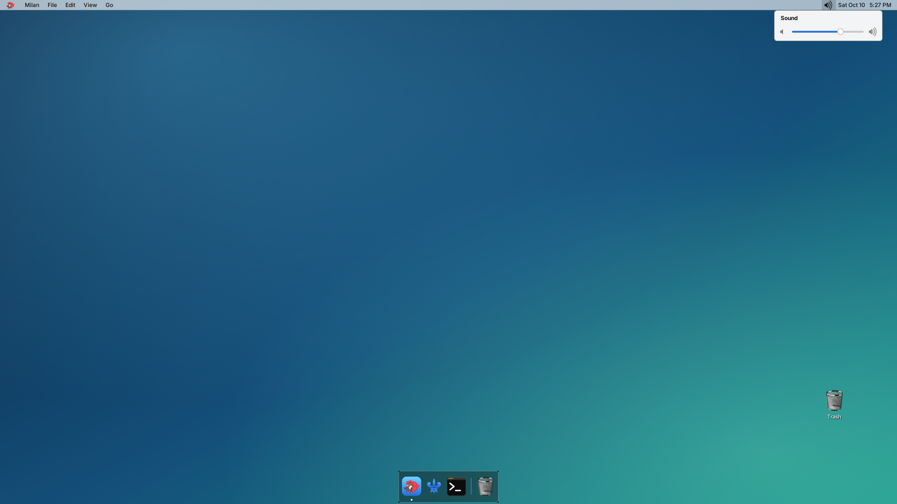

<p align="center"></p>

# Milan

**A small, fast file manager and desktop for GNUstep.** Milan is a Finder-style file manager written in Objective-C for the Raspberry Pi 3 port of Darwin, in the sibling repository [iokit](https://github.com/anurodhp/xnu-iokit-pi3). It is pure AppKit and libdispatch: directory loads, thumbnails and file operations run on GCD queues, and the open folder refreshes live through a kqueue vnode source, so the UI never waits on the disk.

It can also draw the desktop (wallpaper, icons, Trash and volumes), next to the [Naples](https://github.com/anurodhp/naples) dock and menu bar, [Florence](https://github.com/anurodhp/florence) and [Rome](https://github.com/anurodhp/rome).

## What you can do

- Browse in icon, list or column view, with back and forward, a favorites sidebar you can edit (drag a folder in; right-click to remove), sortable list headers, rubber-band selection and type-to-select. Several windows.
- Copy, cut, paste, move, rename, new folder, and drag and drop within a window, between windows, and onto the Trash. Operations run in the background.
- A Trash per volume with a merged Trash view, Put Back, Delete Immediately and Empty Trash. Nothing in the Trash can be opened or run.
- Get Info: any number of non-modal info panels, with folder sizes computed in the background.
- Quick Look (space bar) for images (PNG, TIFF, JPEG), text and folders. Images show as thumbnails in place of the generic icon.
- Open files with their application, Open With, and launch apps (Milan has its own launcher and refuses to start an app twice).
- The desktop (`-MilanDesktop YES`): wallpaper in several fill modes, draggable icons whose positions are remembered, Trash and mounted volumes, a right-click menu and a Change Background panel. Set as Desktop Picture works from the file menu. The wallpaper is also published as `_XROOTPMAP_ID` so translucent bars can blend over it.
- Names in Latin, Greek, Cyrillic and Hebrew are shown correctly (Inter, with DejaVu Sans as a per-run fallback), normalized to NFC so accents compose.
- JPEG decoding (libjpeg-turbo, large files at reduced size), so images work with the stock gnustep-gui.

## What you cannot do (yet)

- No CJK, Korean or emoji in names: no font on the image has them, so they show as `?`. Arabic shows as isolated letters (no shaping), and there is no full bidi algorithm for mixed left-to-right and right-to-left names.
- Quick Look has no PDF, archives or zoom.
- No reordering of favorites by dragging, no eject, no Volumes section in the sidebar.
- No toolbar customization, no tags, no search.
- An app that is already running is not raised, several selected files do not open in one app instance, and "Always open with" is missing for apps that do not declare the type.
- The desktop is started with launch arguments, not a preference or a session autostart. It follows screen-size changes, but that is untested.
- The per-volume Trash has not been tested on a second volume, and the merged Trash view only watches the home Trash for live refresh.
- Building it needs a Mac and the iokit toolchain. There is no prebuilt package, and it is not tested on Linux or macOS.

The full list is in `TODO.md`.

## What has been tested

On a real Raspberry Pi 3, with real input injected through X (`xinject`): sidebar clicks, rubber band, menu-bar and context menus, Get Info, Open With and double-click launching, Quick Look, list-header sorting, all in-window dialogs (Empty Trash, Rename, Delete Immediately), drag to the Trash, drag between windows, drag icons on the desktop, desktop preferences, the wallpaper chooser, type-to-select, Put Back, favorites and image thumbnails. The in-app self test is `Milan -MilanSelfTest YES`.

Not exercised with real input: the look of the sort arrows, drag and drop inside the column view. Not measured: memory use and speed on large folders.

## Building

Milan is cross-built for the Pi with the toolchain and libraries of the [iokit](https://github.com/anurodhp/xnu-iokit-pi3) repository, as a normal GNUstep application. You need:

- the iokit repository checked out next to this one (`../iokit`, or set `IOKIT_DIR`), with its third-party sources fetched;
- Xcode 12 (the iPhoneOS SDK the port is built with) and a current Xcode for its linker;
- GNUstep base, gui and back, and libjpeg-turbo (`libjpeg.62.dylib` in `/usr/X11/lib` on the image) built there.

Then, from this directory:

```sh
./build.sh            # cross-build; Milan.app lands in iokit's libc_build/gnustep/root
./build.sh deploy     # build, then copy Milan.app to the Pi
```

`deploy` uses `DEPLOY_HOST` (default `root@10.0.0.142`).

## Running and testing

On the Pi, Milan is `/Applications/Milan.app`. Settings are GNUstep defaults or command-line arguments (`Milan -MilanViewMode 1`):

| Default | What |
|---|---|
| `MilanDesktop` | `YES` draws the desktop (wallpaper, icons) |
| `MilanOpenBrowser` | `NO` starts without opening a browser window |
| `MilanViewMode` | initial view: 0 icons, 1 list, 2 columns |
| `MilanOrigin`, `MilanInfo` | open at a path, open an info panel at start |
| `MilanSelfTest` | `YES` runs the self test |
| `MilanMultiTest` | `YES` runs the multi-window test |

## Layout

| | |
|---|---|
| `main.m`, `MilanWindow.m`, `MilanPrefs.m` | application, menus, browser windows, preferences |
| `MilanIconView.m`, `MilanListView.m`, `MilanColumnView.m`, `MilanContent.m` | the three views and what they share |
| `MilanEntry.m`, `MilanFileOps.m`, `MilanTrash.m` | directory entries, background file operations, the Trash |
| `MilanIcons.m`, `MilanImage.m`, `MilanQuickLook.m`, `MilanInfoPanel.m`, `MilanDialog.m` | icons and thumbnails, JPEG, Quick Look, Get Info, in-window dialogs |
| `MilanWallpaper.m`, `MilanRootPixmap.m` | the desktop background and its X root pixmap |
| `MilanLauncher.m` | launching apps and documents |
| `MilanText.m`, `MilanNFC.m` | font fallback and Unicode normalization |
| `icons/`, `tools/` | Lucide-derived icons and wallpapers, and the scripts that generate them |
| `docs/` | `desktop-plan.md` (design), `notes.md` |

## License

MIT, see `LICENSE`. Bundled third-party material keeps its own terms:

- `icons/src/*.svg` and the glyphs rendered from them are [Lucide](https://lucide.dev), ISC
  (`icons/LICENSE-lucide.txt`).
- `icons/app/hexley_fork_450.png` and the app icon cut from it: *Hexley DarwinOS Mascot Copyright 2000
  by Jon Hooper. All Rights Reserved.* Included under its own license, not under the MIT license
  (`icons/app/README.md`).
